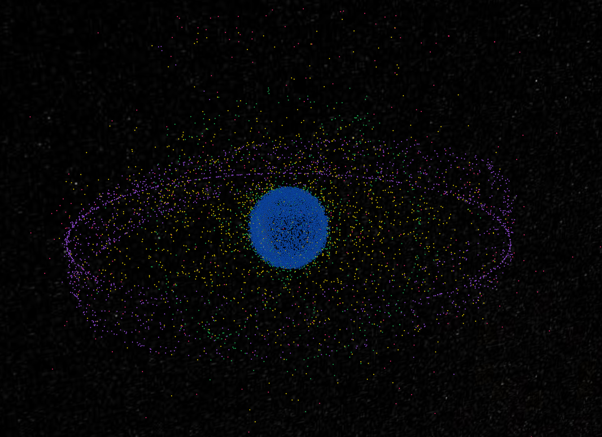
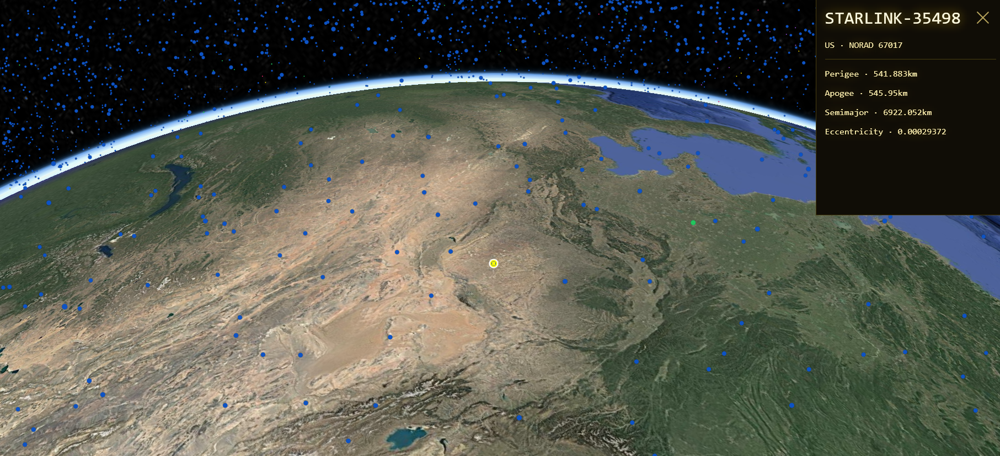

# Welcome to OrbitMap!

A free, open-source orbit map tool showing 30k-ish satellites moving in real time. A Python backend collects orbital data from [Space-Track](https://www.space-track.org), and a React frontend propagates the orbits in the browser and draws them on a Cesium globe.

## Features

- **Live satellite data**: propagated SGP4 data fetched from Space-Track
- **Satellite tracking**: click on a satellite to follow it
- **Orbit classification**: satellites are color-coded based on their orbit type

## Orbit Classification

| Class | Color | Hex | Altitude |
|---|---|---|---|
| LEO (low Earth orbit) | Blue | `#0d53c5` | up to ~2,000 km | |
| MEO (medium Earth orbit) | Green | `#22C55E` | ~2,000 km up to just below geostationary | |
| HEO (highly elliptical orbit) | Yellow | `#ffe600` | low perigee, very high apogee  |
| GEO (geostationary / geosynchronous) | Purple | `#A855F7` | ~35,786 km  |
| NEO | Pink | `#FF2D78` | beyond the classes above | |


## How it works

```
Space-Track -> backend (FastAPI + PostgreSQL) -> frontend (React + Cesium)
```

- **Backend:** fetches element sets from Space-Track, stores them in PostgreSQL, and serves the latest ones. The API supports delta sync, so the frontend only downloads what changed since its last visit.
- **Frontend:** caches data in IndexedDB, propagates orbits with satellite.js (SGP4) in a web worker, and draws all satellites as one Cesium point collection.

## Stack

- **Backend:** Python, FastAPI, PostgreSQL (psycopg)
- **Frontend:** React, TypeScript, Vite, CesiumJS (Resium), satellite.js

## Setup

Python, Node.js, PostgreSQL, a [Space-Track](https://www.space-track.org) account, and a [Cesium ion](https://ion.cesium.com) token are required.

**Backend**

```bash
cd backend
pip install -r requirements.txt
uvicorn <your_module>:app --reload
```

**Frontend**

```bash
cd frontend
npm install
npm run dev
```

## Configuration

Names are placeholders. Use whatever the code reads, and never commit credentials.

| Variable | Used by | Description |
|---|---|---|
| `SPACETRACK_USER`, `SPACETRACK_PASSWORD` | backend | Space-Track login |
| `DATABASE_URL` | backend | PostgreSQL connection string |
| `VITE_CESIUM_ION_TOKEN` | frontend | Cesium ion access token |
| `VITE_API_URL` | frontend | Backend URL |

## API

| Endpoint | Description |
|---|---|
| `GET /latest/elsets` | Latest element sets |
| `GET /latest/satellites` | Satellite metadata |

Both take an optional Unix timestamp (seconds, UTC) and then return only rows changed since then. Without it, they return everything. Responses are arrays without field names, so the column order must match on both sides.

## Notes

- **Units:** satellite.js uses kilometers and Cesium uses meters.
- **Time:** everything is UTC.
- **Space-Track** has rate and size limits, so large backfills may need to be split up.

## Screenshots


